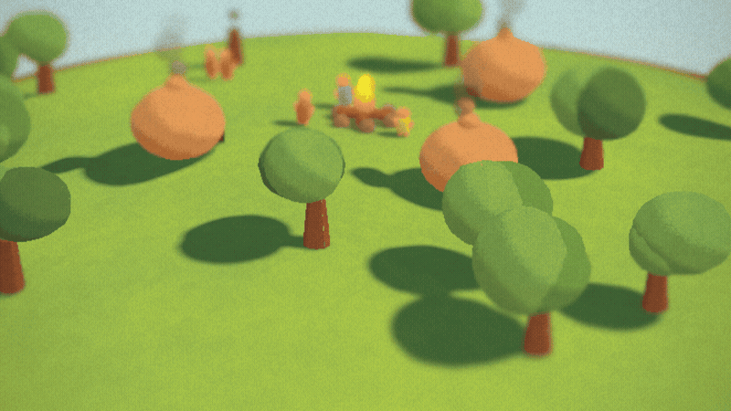

# Tiny God Game

A hand-molded clay island floats in a soft sky. Six tiny villagers live there. You get Meteor, Lightning, and Rain—and a journal of twelve odd little Moments to discover.



## Play locally

```bash
npm install
npm run dev
```

Keyboard play is built in: press `1`, `2`, or `3` to arm a power, move the reticle with the arrow keys, and press `Enter` to cast. The journal is a focus-trapped dialog with an arrow-key tile grid.

## What makes it tick

- Vanilla Three.js, TypeScript, Vite, and `postprocessing`—no UI framework.
- Villager and prop poses are held at 12 fps while the camera, particles, and post stack stay at display rate.
- The island, clay meshes, textures, particles, foley, and ambient bed are procedural. Runtime gameplay ships no model, texture, font, or audio assets.
- A complete power × target matrix makes every one of the 21 cells explicit and testable.
- Twelve event-driven Moments persist locally and appear as pressed thumbprints in a real 3D clay book rendered through the existing WebGL context.
- `prefers-reduced-motion` and `?lowfx=1` retain full keyboard play and a readable DOM journal fallback.

## Checks

```bash
npm test
npm run build
```
